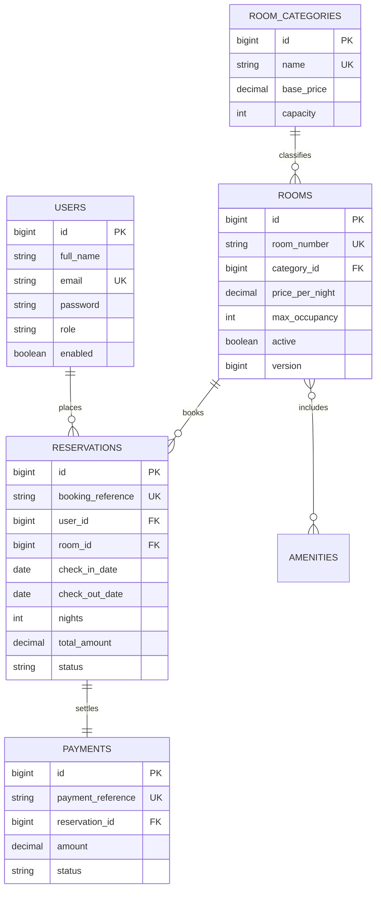

# CodeAlpha - Hotel Reservation & Management System

[](https://www.oracle.com/java/)
[](https://spring.io/projects/spring-boot)
[](https://spring.io/projects/spring-security)
[](https://www.mysql.com/)
[](LICENSE)

An advanced, production-grade **Hotel Reservation and Management Web Application** designed for internship evaluation, technical interviews, and GitHub portfolio presentation. Built using **Spring Boot 3**, **Spring Security (Stateless JWT)**, **Hibernate / Spring Data JPA**, **MySQL**, and a responsive, modern **Vanilla HTML5/CSS3/JavaScript** frontend.

---

## 📌 Table of Contents
1. [Project Overview](#-project-overview)
2. [Key Features](#-key-features)
3. [Technology Stack](#-technology-stack)
4. [Architecture & Design](#-architecture--design)
5. [Database Design & Normalization](#-database-design--normalization)
6. [Core Business Rules & Implementation](#-core-business-rules--implementation)
7. [Getting Started & Running the Project](#-getting-started--running-the-project)
8. [Demo Accounts & Quick Testing](#-demo-accounts--quick-testing)
9. [Simulated Payment Process Notice](#-simulated-payment-process-notice)
10. [REST API Documentation & Postman Collection](#-rest-api-documentation--postman-collection)
11. [Automated Test Suite](#-automated-test-suite)
12. [Limitations & Future Roadmap](#-limitations--future-roadmap)

---

## 🏨 Project Overview

The **Grand Heritage Hotel Reservation System** allows prospective guests to search room inventories in real time based on stay dates and party size, verify live room availability, book rooms, simulate digital checkout transactions, retrieve official reservation vouchers, and self-manage booking cancellations within defined policy limits.

Simultaneously, the platform features a secure **Administrator Management Portal** providing executive analytics, live occupancy tracking, revenue breakdowns with interactive charts, room inventory CRUD, reservation lifecycle transition handling, and one-click CSV report exports.

---

## ✨ Key Features

### 👤 Customer Experience
* **Luxury Hospitality Landing Page:** Responsive showcase of accommodations, hotel amenities, guest testimonials, and search bar.
* **Server-Side Room Availability Filter:** Multi-criteria search (Check-in/Check-out dates, guest count, room category, and price range). Overlapping active bookings are mathematically excluded on the backend database level.
* **4-Step Booking Workflow:**
  * Real-time client preview and authoritative backend cost recalculation (Nights $\times$ Nightly Rate $+$ 12% Hotel GST/Tax).
  * Unique booking reference generation (`BK-YYYY-XXXXXXXX`).
  * Guest details and special request capture.
* **Simulated Digital Payments:** Clear, zero-risk simulation of Credit Card, UPI, and Pay-at-Hotel methods with selectable Success and Failure scenarios.
* **Official Booking Voucher:** Printable reservation voucher with status badges, cost breakdown, and reference numbers.
* **Customer Dashboard ("My Bookings"):** Real-time booking history split into Upcoming, Completed, and Cancelled tabs, with 24-hour self-cancellation eligibility.

### 🛡️ Administrator Management Portal
* **Executive KPI Metrics:** Real-time counters for Total Rooms, Available Rooms Today, Occupied Rooms Today, Total Bookings, and Total Revenue.
* **Interactive Analytics Charts (Chart.js):**
  * 6-Month Monthly Revenue Breakdown.
  * 7-Day Daily Bookings Volume.
* **Room Inventory CRUD:**
  * Add, edit, activate/deactivate, and delete hotel rooms.
  * Category mapping, nightly rate configuration, guest occupancy limits, and amenity assignment.
* **Reservation Lifecycle Management:**
  * Live search by reference, guest email, or room number.
  * Validated status transitions: `PENDING` $\rightarrow$ `CONFIRMED` $\rightarrow$ `CHECKED_IN` $\rightarrow$ `CHECKED_OUT` or `CANCELLED`.
* **RFC 4180 CSV Report Export:** One-click streaming download of complete reservation history.

---

## 🛠️ Technology Stack

| Layer | Technologies Used |
| :--- | :--- |
| **Backend Framework** | Java 17+, Spring Boot 3.3.4 (REST APIs) |
| **Security & Auth** | Spring Security 6, JJWT (io.jsonwebtoken 0.12.6), BCrypt Password Hashing |
| **Persistence & ORM**| Spring Data JPA, Hibernate 6, Jakarta Persistence (JPA) |
| **Databases** | MySQL (Production profile) / H2 In-Memory (Zero-config development fallback) |
| **Validation** | Jakarta Bean Validation (`@NotNull`, `@AssertTrue`, `@FutureOrPresent`) |
| **Frontend** | HTML5, Modern CSS3 (CSS Variables, Flexbox, CSS Grid), Vanilla ES6+ JavaScript |
| **Visuals & Charts** | Chart.js, FontAwesome 6, Google Fonts (Playfair Display & Inter) |
| **Build & Testing** | Apache Maven, JUnit 5, Mockito |

---

## 🏗️ Architecture & Design

The backend conforms strictly to a clean, decoupled 3-tier enterprise architecture:

```
src/main/java/com/hotel/reservation/
├── config/             # Spring Security, JWT filters, data seeding
├── controller/         # REST API endpoints (Auth, Rooms, Reservations, Payments, Admin)
├── dto/                # Data Transfer Objects (Requests & Responses)
├── entity/             # JPA Relational Entities (User, Room, Reservation, Payment, etc.)
├── exception/          # Centralized GlobalExceptionHandler & custom domain exceptions
├── repository/         # Spring Data JPA interfaces with JPQL queries
└── service/            # Core business rules, pricing engine, transaction management
```

### Core Java Classes
* `SecurityConfig`: Configures stateless JWT authentication, password encoder beans, and URL authorization rules.
* `JwtTokenProvider`: Issues and verifies HMAC-SHA signed JWT tokens containing username and role claims.
* `ReservationService`: Implements core booking logic, transactional concurrency control, price calculation, and cancellation policies.
* `RoomRepository`: Contains custom JPQL query for date overlap detection:
  $$\text{checkIn} < \text{requestedCheckOut} \quad \text{AND} \quad \text{checkOut} > \text{requestedCheckIn}$$
* `GlobalExceptionHandler`: Central advice mapping validation and domain exceptions into uniform `ApiResponse<T>` JSON structures.

---

## 🗄️ Database Design & Normalization

The schema is in Third Normal Form (3NF) to eliminate redundancy and maintain referential integrity.



* Standalone SQL DDL file: [`schema.sql`](file:///c:/Users/KEERTHANA/OneDrive/Desktop/Hostel_Reservation_System/schema.sql)
* Standalone sample seed data: [`data.sql`](file:///c:/Users/KEERTHANA/OneDrive/Desktop/Hostel_Reservation_System/data.sql)

---

## ⚖️ Core Business Rules & Implementation

| # | Business Rule | Backend Implementation Mechanism |
| :- | :--- | :--- |
| **1** | Check-out must be after check-in | `@AssertTrue` in `ReservationRequest` and validation in `ReservationService`. |
| **2** | Guest count within room capacity | Validated in `ReservationService`: `numberOfGuests <= room.getMaxOccupancy()`. |
| **3** | Prevention of double bookings | Server-side query `hasOverlappingReservation` executed inside `@Transactional(isolation = READ_COMMITTED)`. |
| **4** | Server-side price calculation | Backend computes: $\text{nights} \times \text{rate} + 12\%\text{ Tax}$ (client price input is never accepted). |
| **5** | Customer data isolation | Authenticated principal checked in `getReservationByReference` and `cancelReservation`. |
| **6** | Cancellation policy | Permitted only for `CONFIRMED` or `PENDING` bookings up to 24 hours prior to check-in. |
| **7** | Concurrency safety | Optimistic locking on `Room` via `@Version` prevents race-condition collisions. |
| **8** | Safe error messages | Central `GlobalExceptionHandler` logs traces internally and returns sanitized client JSON. |

---

## 🚀 Getting Started & Running the Project

### Prerequisites
* **Java Development Kit (JDK):** Version 17, 21, or 24 installed (`java -version`).
* **Maven:** Version 3.8+ or preferred IDE with Maven support (IntelliJ IDEA, Eclipse, VS Code).
* **MySQL (Optional):** Version 8.0+ (default configuration uses embedded H2 for instant zero-setup execution).

### Option A: Run with Default Embedded Database (Instant Zero-Config)
The application is pre-configured with H2 in-memory mode and automatic data seeding (`DataInitializer.java`):

```bash
# 1. Clone repository
git clone https://github.com/your-username/CodeAlpha_HotelReservationSystem.git
cd CodeAlpha_HotelReservationSystem

# 2. Run application using Maven
mvn spring-boot:run
```

Once started, open your web browser at:
* **Hotel Home Page:** [http://localhost:8080](http://localhost:8080)
* **Rooms Catalog:** [http://localhost:8080/rooms.html](http://localhost:8080/rooms.html)
* **Sign In:** [http://localhost:8080/login.html](http://localhost:8080/login.html)
* **Admin Dashboard:** [http://localhost:8080/admin.html](http://localhost:8080/admin.html)
* **H2 Console:** [http://localhost:8080/h2-console](http://localhost:8080/h2-console) (JDBC URL: `jdbc:h2:mem:hotel_db`, User: `sa`, Password: empty)

---

### Option B: Run with MySQL Database
To use MySQL:
1. Ensure MySQL is running on your machine.
2. Create the database:
   ```sql
   CREATE DATABASE hotel_reservation_db CHARACTER SET utf8mb4 COLLATE utf8mb4_unicode_ci;
   ```
3. Set your credentials in `src/main/resources/application-mysql.properties` or via environment variables:
   ```bash
   export DB_HOST=localhost
   export DB_PORT=3306
   export DB_NAME=hotel_reservation_db
   export DB_USERNAME=root
   export DB_PASSWORD=your_mysql_password
   ```
4. Start the application with the MySQL profile:
   ```bash
   mvn spring-boot:run -Dspring-boot.run.profiles=mysql
   ```

---

## 🔑 Demo Accounts & Quick Testing

For interview evaluation, the application provides pre-seeded accounts and **1-click Quick Login buttons** on the sign-in screen:

| Role | Email Address | Password | Privileges |
| :--- | :--- | :--- | :--- |
| **Administrator** | `admin@hotel.com` | `Admin@123` | Full access to KPI stats, charts, room inventory CRUD, reservations manager, and CSV export. |
| **Customer** | `john@example.com` | `Customer@123` | Room searching, creating reservations, simulated checkout, viewing booking history, cancelling stays. |

---

## 💳 Simulated Payment Process Notice

> [!IMPORTANT]
> **SIMULATED TRANSACTION ENVIRONMENT:**
> This project contains a purely simulated financial checkout flow for demonstration purposes.
> - **No real money is charged.**
> - **No bank accounts, actual cards, or CVVs are collected or stored.**
> - The checkout screen allows testing both **Successful Approvals** and **Simulated Declines** to verify status transitions and error handling.

---

## 📡 REST API Documentation & Postman Collection

Import the included file [`Hotel_Reservation_API_Collection.json`](file:///c:/Users/KEERTHANA/OneDrive/Desktop/Hostel_Reservation_System/Hotel_Reservation_API_Collection.json) into Postman or Insomnia.

### Key Endpoints:
* `POST /api/auth/register` &mdash; Register guest
* `POST /api/auth/login` &mdash; Authenticate and obtain JWT Bearer token
* `GET  /api/rooms/search` &mdash; Query available rooms by date and capacity
* `POST /api/reservations` &mdash; Create booking hold (Authenticated)
* `GET  /api/reservations/my` &mdash; Retrieve authenticated customer's bookings
* `POST /api/payments/simulate` &mdash; Process simulated payment transaction
* `GET  /api/admin/dashboard/stats` &mdash; Retrieve admin KPI metrics & chart data (Admin only)
* `POST /api/admin/rooms` &mdash; Create hotel room (Admin only)
* `GET  /api/admin/reports/reservations/export-csv` &mdash; Stream CSV reservation report (Admin only)

---

## 🧪 Automated Test Suite

Unit and integration tests are built using **JUnit 5** and **Mockito**:

```bash
# Execute test suite
mvn test
```

### Covered Test Cases:
* Room availability calculations with boundary dates.
* Overlapping date collision prevention (`RoomNotAvailableException`).
* Cross-field validation (Check-out before check-in, past check-in).
* Room capacity validation (Number of guests exceeding room maximum).
* Backend price calculation verification (Nights $\times$ Rate $+$ 12% Tax).
* Customer isolation enforcement (Unauthorized customers blocked from modifying others' bookings).
* Cancellation policy enforcement (Same-day cancellation rejection).
* Payment simulation status transitions (`PENDING` $\rightarrow$ `CONFIRMED` on approval).

---

## 🔭 Limitations & Future Roadmap

* **Email Confirmation Dispatch:** Integration with Spring Mail / SendGrid to transmit PDF vouchers via SMTP.
* **OAuth2 Social Sign-In:** Google / GitHub login integration.
* **Dynamic Seasonal Pricing:** Algorithm-adjusted pricing based on high-occupancy weekends and holiday dates.
* **Multi-Currency Support:** Currency conversion API for international guests.

---

## 📄 License
This project is licensed under the MIT License &mdash; free for educational and personal portfolio use.
